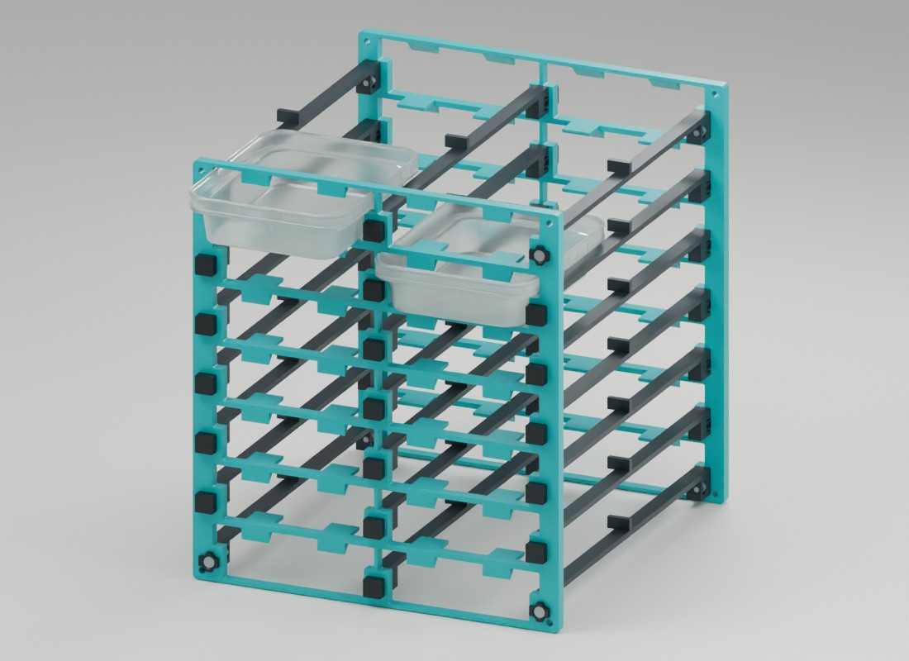
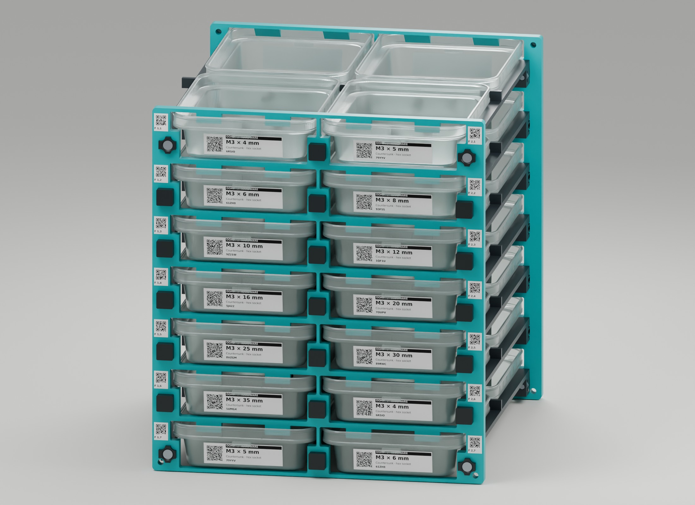
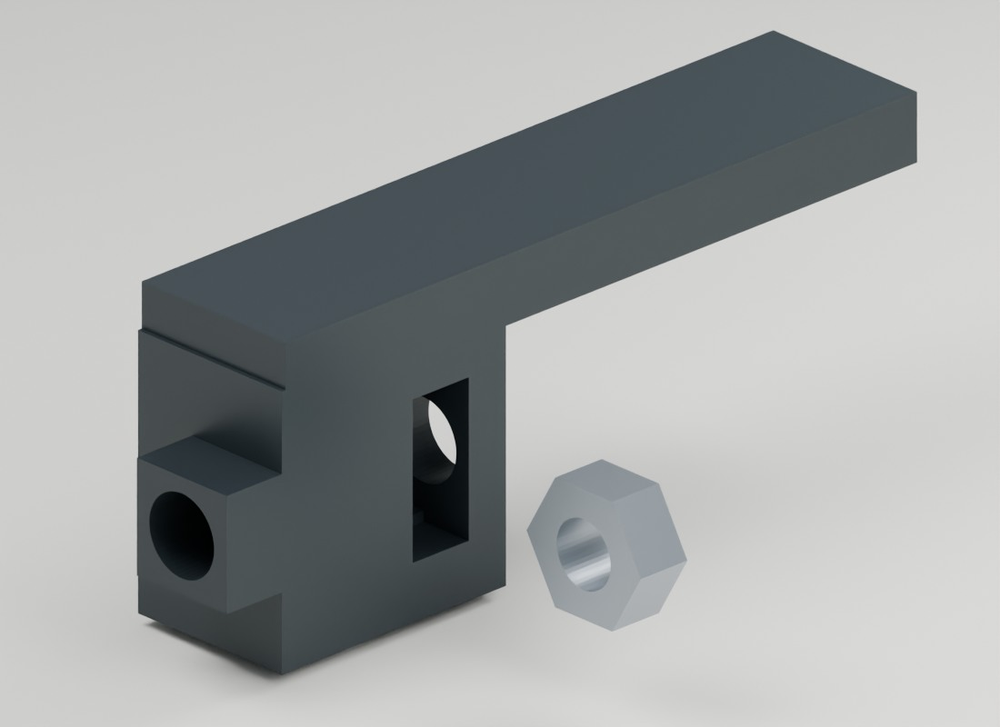
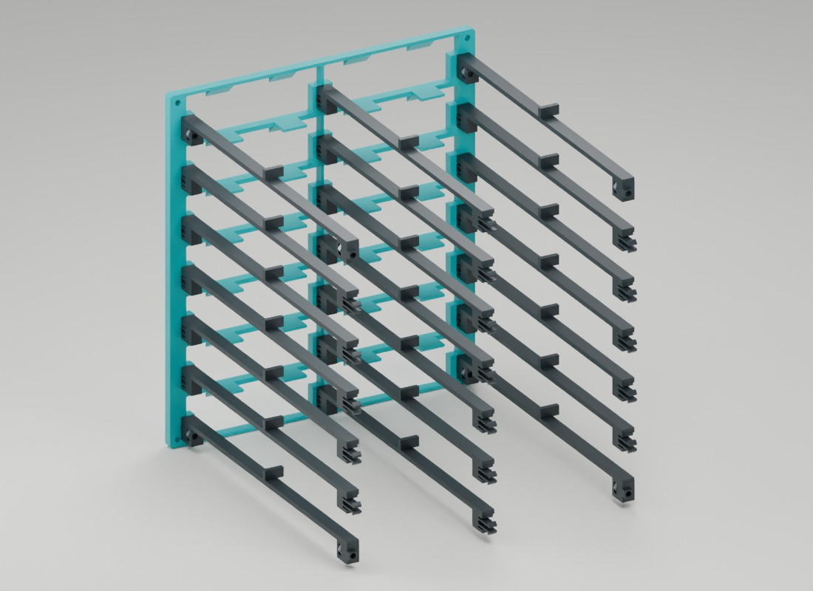
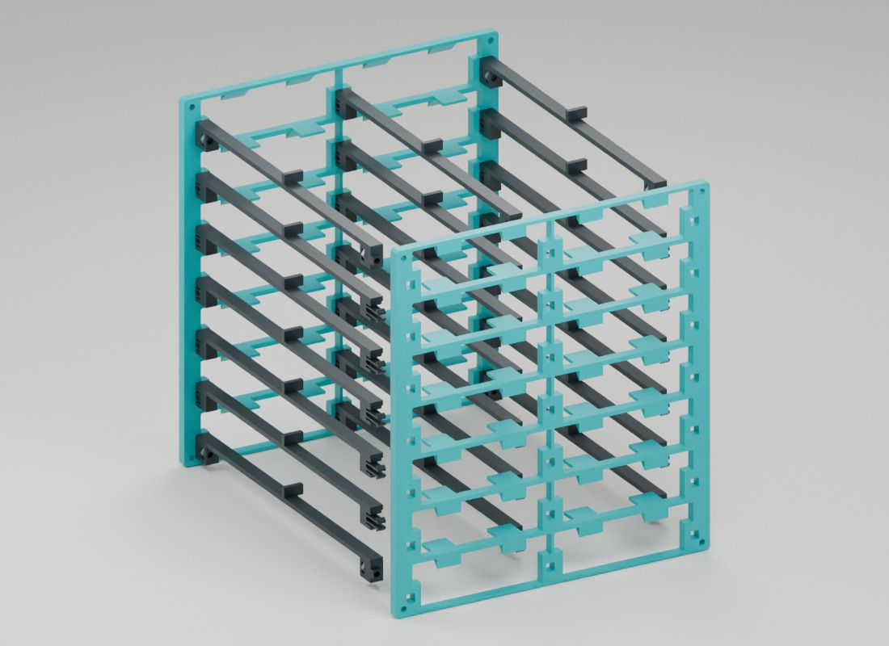
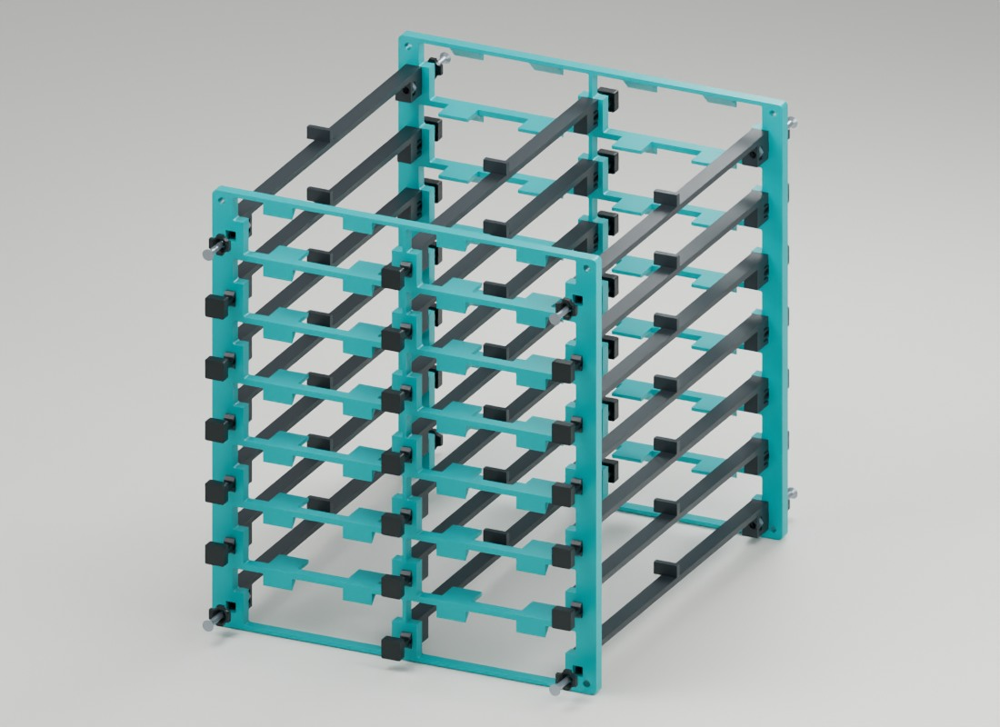
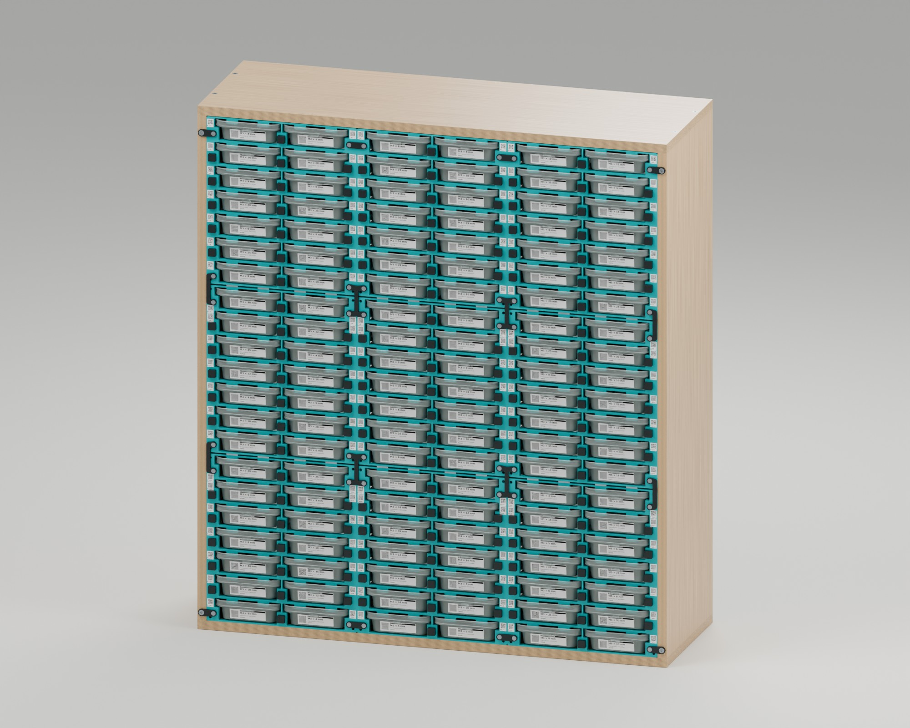
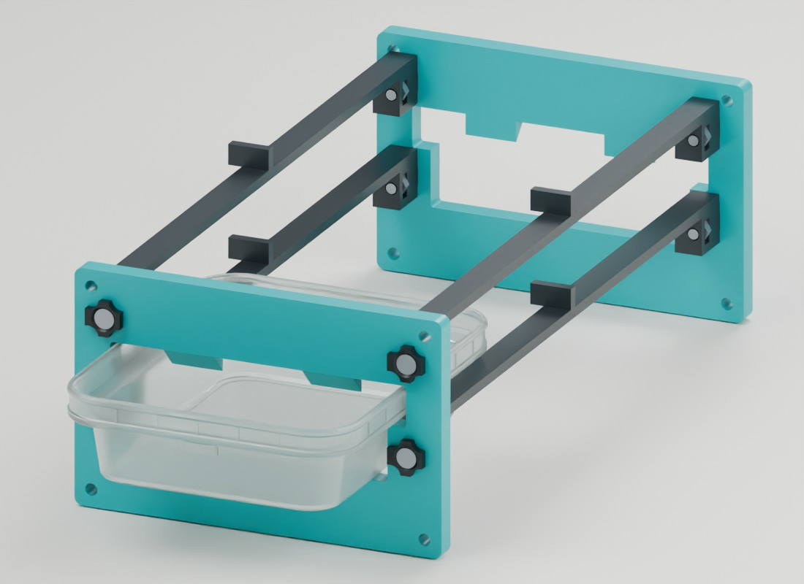
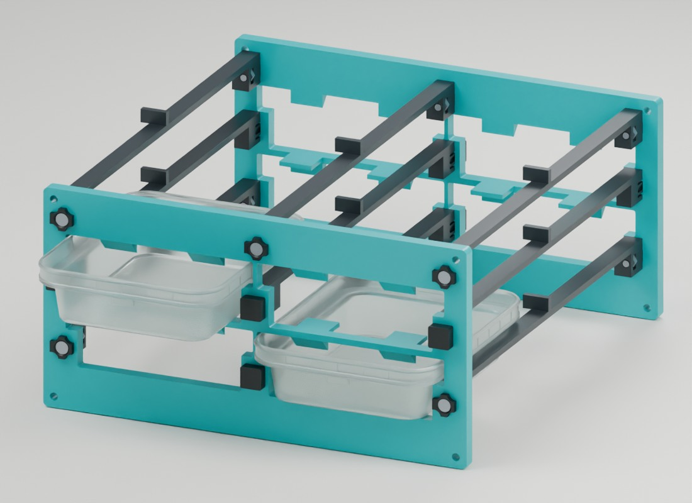

# Drawer units for takeaway pots

Use a takeaway pot as the drawer. Two faceplates and a set of rails hold opposing banks of removable pots, so a frame can be opened from either side.

This project was largely AI-generated. Editable CAD sources and print kits are included. AI-generated CAD images and instructions. Errors possible. Check fit on your printer before making a full set.

**Featured build · [2 × 7 drawer unit](parts/oobb_organization_storage_drawer_unit_systempak_209_100_ml_2_column_7_row_v8/README.md).** 14 pots per face, 28 in total. The removable Systempak 209 pots slide in from either side.

This build uses two handed faces, 17 snap beams and 4 screw beams. For a fastener cabinet, one bank can hold screws and the opposite bank their matching nuts.

[View the illustrated manual](parts/oobb_organization_storage_drawer_unit_systempak_209_100_ml_2_column_7_row_v8/assembly.pdf) · [Download PDF](https://raw.githubusercontent.com/oomlout/organization_storage_drawer_unit/main/parts/oobb_organization_storage_drawer_unit_systempak_209_100_ml_2_column_7_row_v8/assembly.pdf) · [Download offline HTML](parts/oobb_organization_storage_drawer_unit_systempak_209_100_ml_2_column_7_row_v8/assembly.html?raw=true)

Each slot has a permanent XY address. Each pot has a separate contents label. Scan either QR code or read the printed identifier.

### Assemble the featured build

| Load the nuts | Seat the beams | Fit the rear face | Lock both faces |
| --- | --- | --- | --- |
|  |  |  |  |

## Current version · V8

[3 × 3 cabinet of 2 × 7 units · cut list, drilling and assembly](parts/oobb_organization_storage_drawer_unit_systempak_209_100_ml_2x7_array_3_by_3_plywood_cabinet_v8/README.md)

### Systempak 209 · 100 ml

| Build | Grid per face | Pots | Assembly | Print kit |
| --- | --- | ---: | --- | --- |
|  | [1 × 1 drawer unit](parts/oobb_organization_storage_drawer_unit_systempak_209_100_ml_1_column_1_row_v8/README.md) | 2 | [Illustrated guide](parts/oobb_organization_storage_drawer_unit_systempak_209_100_ml_1_column_1_row_v8/assembly.pdf) | [Print list](parts/oobb_organization_storage_drawer_unit_systempak_209_100_ml_1_column_1_row_v8/printing.txt) |
|  | [2 × 2 drawer unit](parts/oobb_organization_storage_drawer_unit_systempak_209_100_ml_2_column_2_row_v8/README.md) | 8 | [Illustrated guide](parts/oobb_organization_storage_drawer_unit_systempak_209_100_ml_2_column_2_row_v8/assembly.pdf) | [Print list](parts/oobb_organization_storage_drawer_unit_systempak_209_100_ml_2_column_2_row_v8/printing.txt) |
|  | [2 × 7 drawer unit](parts/oobb_organization_storage_drawer_unit_systempak_209_100_ml_2_column_7_row_v8/README.md) | 28 | [Illustrated guide](parts/oobb_organization_storage_drawer_unit_systempak_209_100_ml_2_column_7_row_v8/assembly.pdf) | [Print list](parts/oobb_organization_storage_drawer_unit_systempak_209_100_ml_2_column_7_row_v8/printing.txt) |

**[Corner screw-beam joining brackets](parts/oobb_organization_storage_drawer_unit_systempak_209_100_ml_joiners_v8/README.md)** · [Print and installation instructions](parts/oobb_organization_storage_drawer_unit_systempak_209_100_ml_joiners_v8/README.md)

**[Corner screw-beam to plywood joint](parts/oobb_organization_storage_drawer_unit_systempak_209_100_ml_plywood_joint_v8/README.md)** · [Print and installation instructions](parts/oobb_organization_storage_drawer_unit_systempak_209_100_ml_plywood_joint_v8/README.md)

## Design versions

[Browse the archived source and manufacturing records](https://github.com/oomlout/organization_storage_drawer_unit/tree/main/history).

| Version | Design notes |
| --- | --- |
| [V8](parts/oobb_organization_storage_drawer_unit_systempak_209_100_ml_2_column_7_row_v8/README.md) | Current frame catalogue and assembly guides |
| [V7](https://github.com/oomlout/organization_storage_drawer_unit/blob/main/history/AI_VERSION_7.md) | Through-panel clips and interchangeable beams |
| [V6](https://github.com/oomlout/organization_storage_drawer_unit/blob/main/history/AI_VERSION_6_DOUBLE_SIDED.md) | Double-sided plywood enclosure |
| [V5](https://github.com/oomlout/organization_storage_drawer_unit/blob/main/history/AI_VERSION_5_TILED.md) | Tiled PETG frames |
| [V4](https://github.com/oomlout/organization_storage_drawer_unit/blob/main/history/AI_VERSION_4.md) | Modular drawer units |
| [V3](https://github.com/oomlout/organization_storage_drawer_unit/blob/main/history/AI_VERSION_3.md) | Revised lower supports |
| [V2](https://github.com/oomlout/organization_storage_drawer_unit/blob/main/history/AI_VERSION_2.md) | Interlocking junctions |
| [V1](https://github.com/oomlout/organization_storage_drawer_unit/blob/main/history/AI_VERSION_1.md) | First locked frame |

## Suggest a tray

[Suggest a tray size](https://github.com/oomlout/organization_storage_drawer_unit/issues/new?title=Tray+size+suggestion&body=Tray+manufacturer+and+model%3A%0ACapacity+%28ml%29%3A%0ARim+width%2C+depth+and+height+%28mm%29%3A%0ABody+width+below+the+rim+%28mm%29%3A%0ADesired+columns+and+rows+per+face%3A%0APhoto+or+datasheet%3A) with its rim and body measurements and the grid you want. To build a variant locally, add its tray and layout to the population file and run make-all. [Build and authoring guide](https://github.com/oomlout/organization_storage_drawer_unit/blob/main/BUILD.md).
