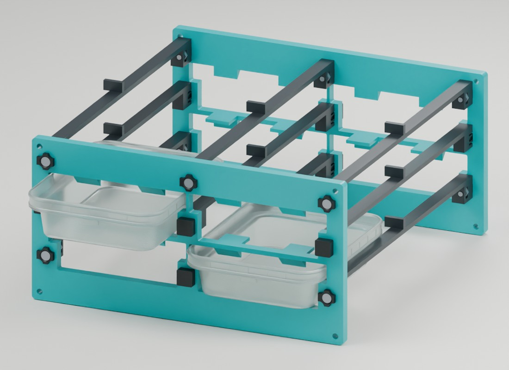
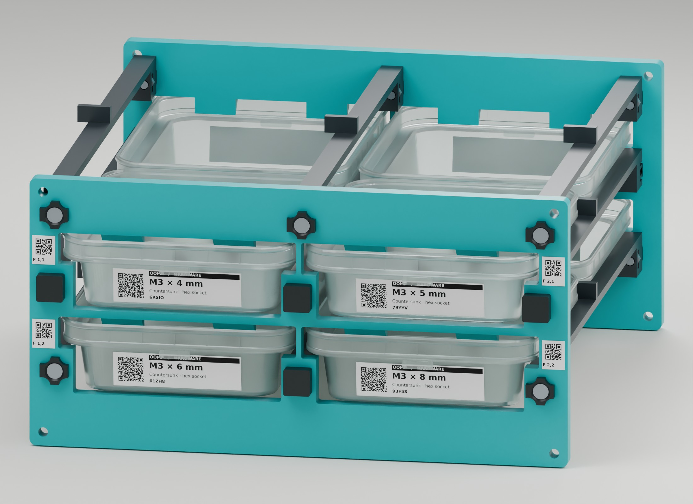
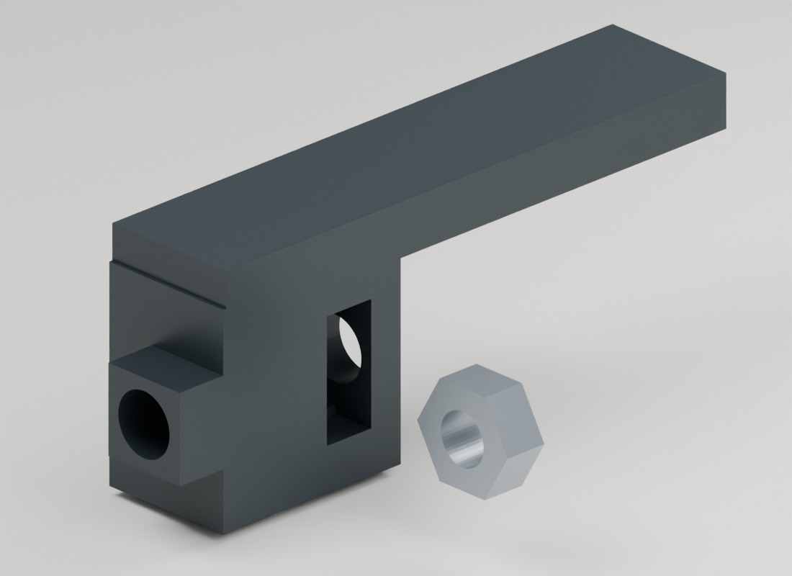
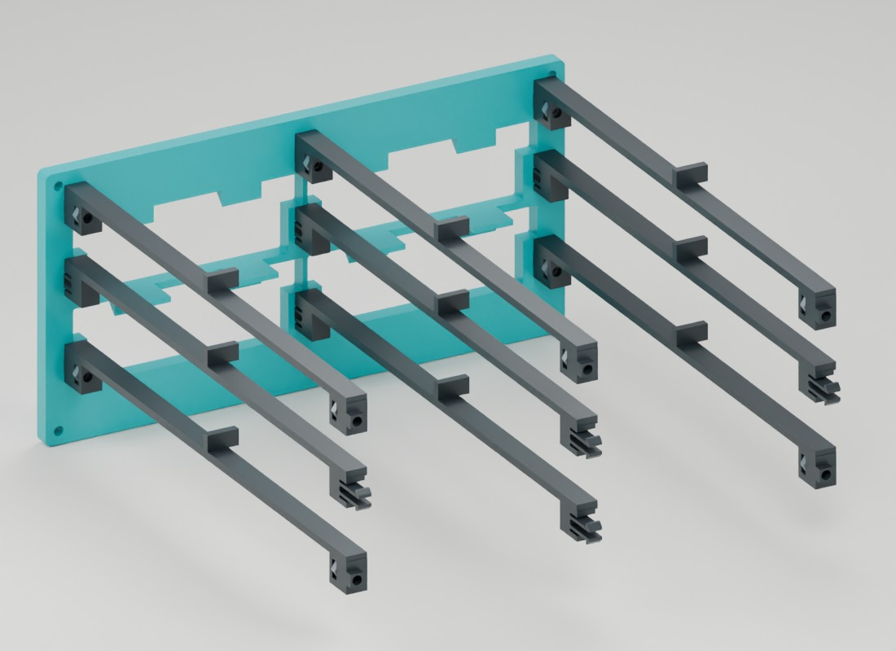
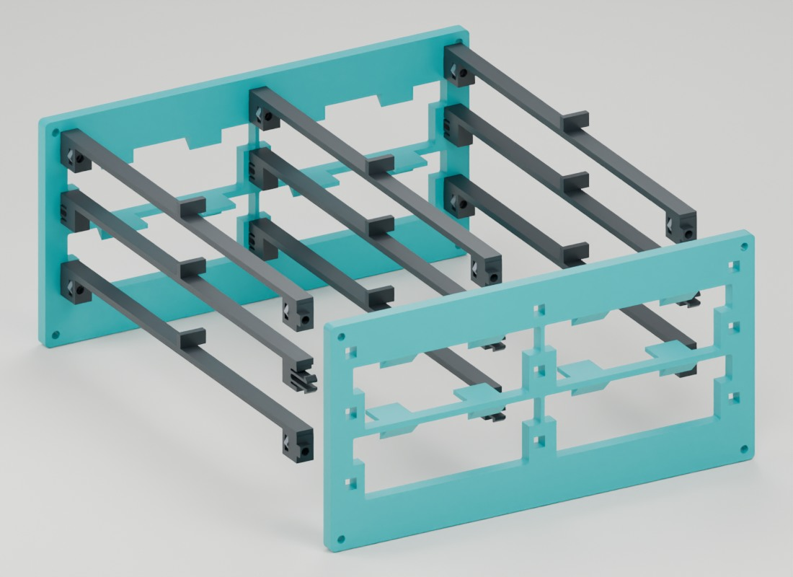
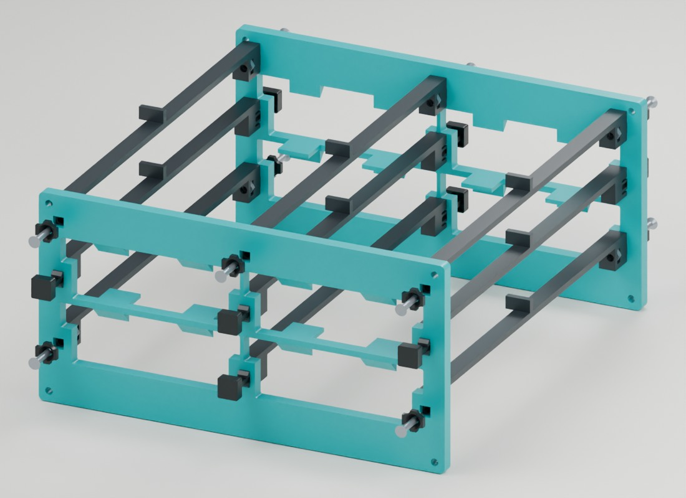

# 2 × 2 drawer unit

2 × 2 openings on each face. The two banks hold 8 100 ml Systempak 209 pots in total.

This project was largely AI-generated. Editable CAD sources and print kits are included. AI-generated CAD images and instructions. Errors possible. Check fit on your printer before making a full set.

[Printing instructions](printing.txt) · [Assembly data](assembly.json)

[View the illustrated manual](assembly.pdf) · [Download PDF](https://raw.githubusercontent.com/oomlout/organization_storage_drawer_unit/main/parts/oobb_organization_storage_drawer_unit_systempak_209_100_ml_2_column_2_row_v8/assembly.pdf) · [Download offline HTML](assembly.html?raw=true)

## Details

Face size is 197.8 × 99.8 mm. The outside faces are 209 mm apart. The kit uses a 197 mm inside rail span. The enclosure supplies the bottom floor.

Print each handed face and each listed batch once. Individual component files are spares. For a laser build, cut the 6 mm face pattern twice, or cut one complete 3 mm reinforced trial pattern per face.

[6 mm laser face](front_laser_2d.dxf) · [3 mm reinforced trial](front_3mm_test_2d.dxf)

**Print one of each file**

[Front face](front.stl), [rear face](back.stl), [snap_beams](snap_beams.stl), [screw_beams](screw_beams.stl), [front_plugs_square](front_plugs_square.stl), [screw_adapters](screw_adapters.stl).

## Stocked unit

The modelled open pot is 27 mm high. The closed package is 29 mm high and the frame opening is 28.5 mm. Both banks are shown with lids removed. [Manufacturer photos](https://systempak.net/product/100ml-rectangular-tamper-evident-containers-and-lids/) · [Technical sheet](https://systempak.net/wp-content/uploads/2024/03/TDS-209-100ML.pdf).

The fixed frame label identifies the face, column and row. The larger label on the removable pot identifies its example OOMP contents. Each label has its own QR code.

[Rear view](stocked-rear.jpg) · [Label close-up](stocked-detail.jpg) · [Fixed location labels](labels-location.pdf) · [Replaceable contents labels](labels-contents.pdf) · [Individual label artwork](labels/) · [Slot assignments](label-map.json) · [Reference model fit](pot-fit.json)

[Joining brackets](../oobb_organization_storage_drawer_unit_systempak_209_100_ml_joiners_v8/README.md) and [frame-to-plywood joint](../oobb_organization_storage_drawer_unit_systempak_209_100_ml_plywood_joint_v8/README.md)

## Parts

Quantities for one complete frame.

| Part | Quantity |
| --- | ---: |
| [Front face](front.stl) | 1 |
| [Rear face](back.stl) | 1 |
| [Snap beam](snap_beam.stl) | 4 |
| [Screw beam](screw_beam.stl) | 5 |
| [Square cap](front_plug_square.stl) | 8 |
| [Screw adapter](screw_adapter.stl) | 10 |
| [M3 × 20 countersunk screw](https://github.com/oomlout/oomp_hardware_screw_version_5/tree/main/parts/hardware_screw_countersunk_hex_head_black_m3_diameter_20_mm_length) | 10 |
| [M3 hex nut](https://github.com/oomlout/oomlout_oomp_version_1_messy/tree/main/parts/hardware_nut_m3) | 10 |
| Systempak 209 pot, 100 ml | 8 |

## Assembly

Print in the supplied orientations. Clear loose filament from the screw bores and nut pockets before fitting hardware.

### 1. Load the screw beams

Slide an M3 nut into the side pocket at each end of all 5 screw beams. The close-up shows one end. Align each nut with its axial bore.

### 2. Seat the beams in the front

Place the front face outside-down. Seat the 4 snap beams and the loaded screw beams from the inside. Use the mount map in assembly.json. The runner stops point up in service.

### 3. Close the rear face

Match the handed rear face to the free beam ends. Press evenly so both ends of every beam enter their receivers. Keep the caps and adapters accessible from outside.

### 4. Lock both faces

Press the square caps over the snap ends. Seat the screw adapters and fit one M3 × 20 countersunk screw per adapter (10 total). Slide a pot into each bank to check travel.

The [validation report](validation.json) records nominal CAD fit. Print tolerances, strength and long-term loading still need a physical trial.
