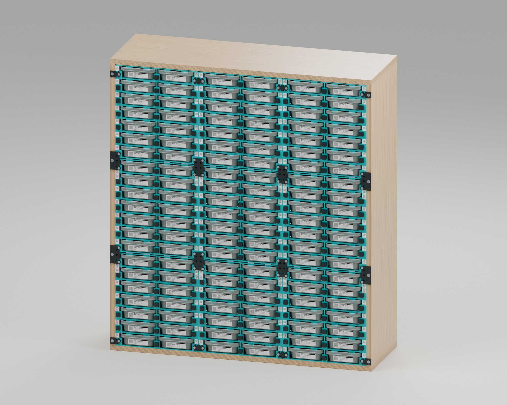
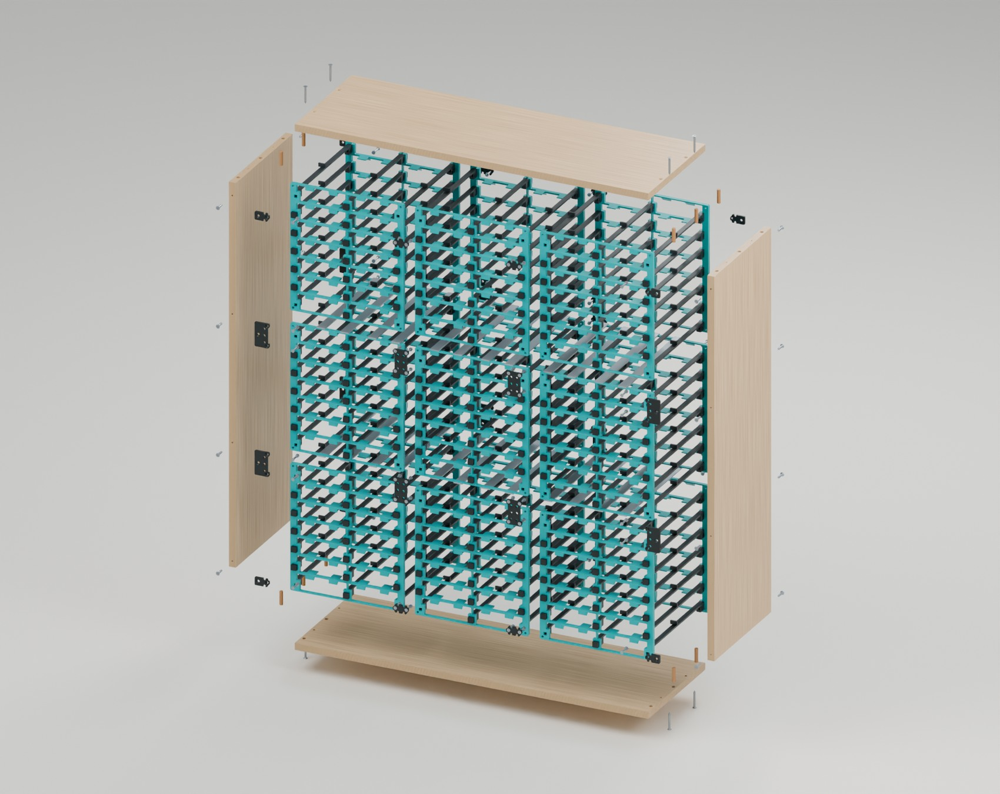
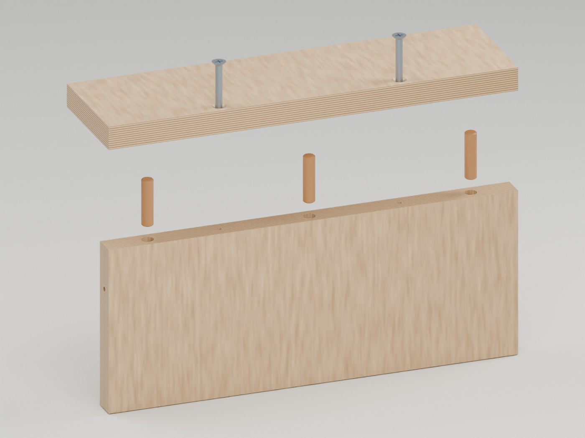

# Nine-unit 2 × 7 drawer cabinet

Nine double-sided V8 frames make a six-column, twenty-one-row cabinet on each face. It holds 126 open SystemPAK 209 pots per face, 252 total.

[Editable assembly](assembled.scad) · [Stocked CAD](stocked.scad) · [Exploded CAD](exploded.scad) · [2 × 7 frame files](../oobb_organization_storage_drawer_unit_systempak_209_100_ml_2_column_7_row_v8/README.md)

## Cut and drill

The plywood case measures **617.4 mm wide × 689.5 mm high × 209 mm deep**. Both side panels fit between the top and bottom. The top and bottom finish flush with the outer side faces (0 mm overhang). Cut them to the assembled outside width. The front and rear edges of the plywood align with the frame faceplates. Clip caps, fasteners and pots can project beyond those open edges.

| Piece | Quantity | Finished length × width × thickness, mm |
| --- | ---: | --- |
| Top / bottom | 2 | 617.4 × 209 × 12 |
| Left / right side | 2 | 665.5 × 209 × 12 |
| Inter-tier floor strip | 24 | 209 × 15 × 2 |

Seat the side panels directly against the array. Dry-fit the actual three-frame width before cutting the caps. Leave 0.6 mm above the array. The two inter-tier gaps are 2 mm each. Four narrow strips under each upper frame continue the floor support normally provided by the base. Position each pair 20.5 mm either side of its opening centre. Bond the strip ends to the lower frame's front and rear top edges before tightening the ties.

[Cut list](cut-list.csv) · [Drill schedule](drilling.csv) · [Cap inside face](cap_inside.dxf) · [Side top/bottom end](side_end.dxf) · [Side front/rear edge](side_front_edge.dxf)

## Screw the frames together

1. Assemble nine standard 2 × 7 frames. Use their normal faceplates and preload the original beam nuts. Fit the runner strips between tiers.
2. Remove the individual adapters at each outer corner of every module, front and rear. Keep the M3 × 20 countersunk beam screws. Seat each bracket in the exposed receivers and reinstall those screws in the beam nuts.
3. Print eight [across plates](edge_across.stl) and eight [four-way plates](tee4.stl) for the interior junctions. Each plate is 3 mm thick. The four-way pattern includes the 2 mm tier gap.
4. Print eight [single-contact plywood plates](plywood_joint.stl) for the outside corners and eight [two-contact plywood plates](plywood_double.stl) for the side junctions between tiers. The straight edge finishes flush with the outside of the plywood. Each plate uses one wood screw centred across the side panel. The two-contact plate reuses one M3 beam screw from each frame.

On the middle and bottom tiers, centre the first two rows of fixed location stickers **9.65 mm and 20.85 mm below the upper corner beam axis**, respectively. Keep them centred across the faceplate side margin. These positions clear the vertical brackets and the next row of caps. The other rows use the standard frame positions.

## Join the four plywood sheets

Each of the four plywood corners uses **three Ø6 × 24 mm dowels and two 3.5 × 30 mm countersunk wood screws**. Total twelve dowels and eight case screws. Along the 209 mm depth, measure 22, 58.5, 104.5, 150.5, 187 mm from the front edge. The sequence is dowel, screw, dowel, screw, dowel.

1. Centre all five bores on the side thickness, 6 mm from either side face. Use the inside cap drawing for the mating centres. Drill the Ø6.1 dowel bores 8 mm into the cap and 17 mm into the side end. This leaves 4 mm of plywood over each blind cap bore and 1 mm total axial allowance for the dowel.
2. Drill Ø4 clearance through the caps at the two screw stations. Countersink the **outside** to Ø7. Drill Ø2.5 pilots 21 mm deep into each side end. Match the countersink to the actual screw head and check the pilot in an offcut of the chosen plywood.
3. Dry-fit the dowels and panels around the array. Seat the dowels in the blind bores, clamp square, then drive the two case screws at each joint from the outside. Insert the array from an open face if the case was built separately.
4. Fasten each of the sixteen plywood plates into a side's front or rear edge with one **3.5 × 16 mm countersunk wood screw** in its Ø2.5 pilot. These plates keep the array from sliding out of the shell. Install the pots after tightening.

The [fit report](validation.json) checks the produced CAD solids, both banks of pots and the added hardware. Structural load capacity, dowel fit and screw holding strength require a physical trial. The [location labels](labels-location.pdf) use a distinct address on each face of the full cabinet. [Contents labels](labels-contents.pdf) · [Label map](label-map.json).
