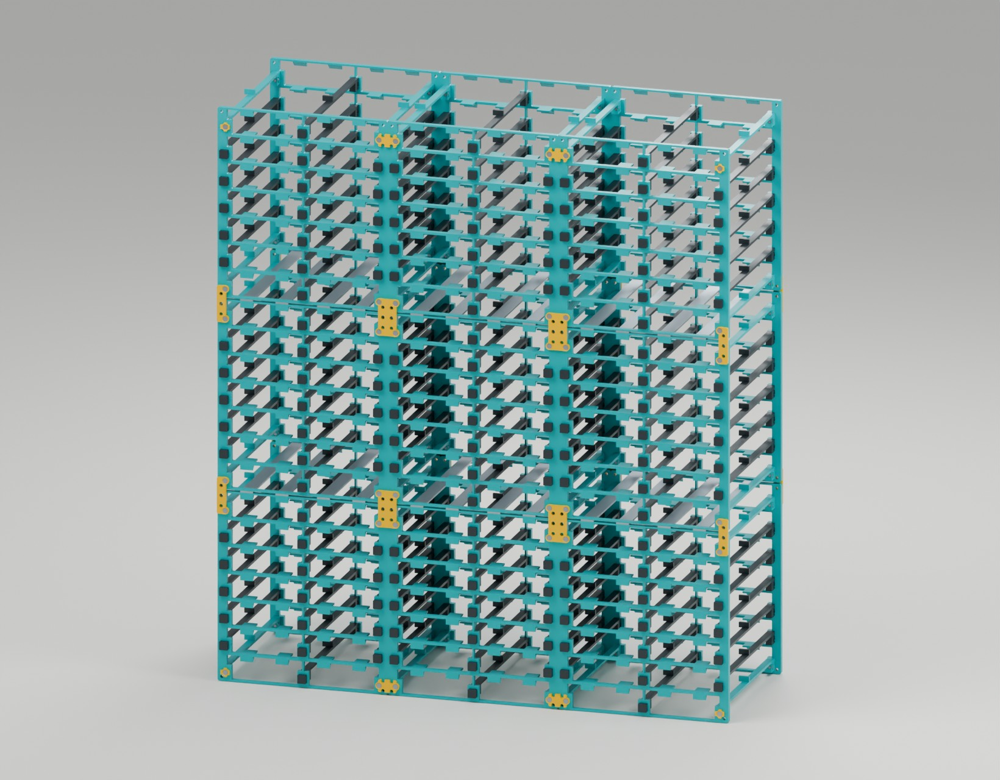

# 3 × 3 drawer array

9 double-sided 2 × 7 frames make 6 columns and 21 rows on each face. The array holds 252 Systempak 209 pots.

[Complete Bambu Studio print kit](working.3mf) · [Plate contents](print-plates.json) · [Frame assembly guide](../oobb_organization_storage_drawer_unit_systempak_209_100_ml_2_column_7_row_v8/README.md) · [Fit checks](validation.json)

The print kit groups faceplates and screw beams on teal plates, snap beams and caps on black plates, and joiners and corner adapters on yellow. Each piece has its own editable filament assignment in Bambu Studio.

## Assembly

1. Print the complete kit once. Load the captive nuts into the four corner screw beams on each frame before seating the faces.
2. Lay out 3 frames across and 3 high. At each tier seam, fit four 15 × 2 × 209 mm aluminium strips under each frame, 24 strips in total.
3. On each face, fit the two-hole horizontal brackets along the top and bottom and the two-hole upright brackets along the sides. Fit a four-hole plate at each interior crossing. The upright and four-hole brackets match the tier gap.
4. Fit a standard adapter at each exposed outer corner. Drive one M3 × 20 countersunk screw into each beam end. Repeat at the rear.

| Fitting | Quantity across both faces |
| --- | ---: |
| Horizontal two-hole joiner | 8 |
| Upright two-hole joiner | 8 |
| Four-hole joiner | 8 |
| Single corner adapter | 8 |
| M3 × 20 countersunk screw | 72 |
| M3 nut | 72 |

Supply the aluminium strips, screws, nuts and pots separately.

[Assembled CAD](assembled.scad) · [Exploded CAD](exploded.scad) · [Assembly BOM](assembly.json)
