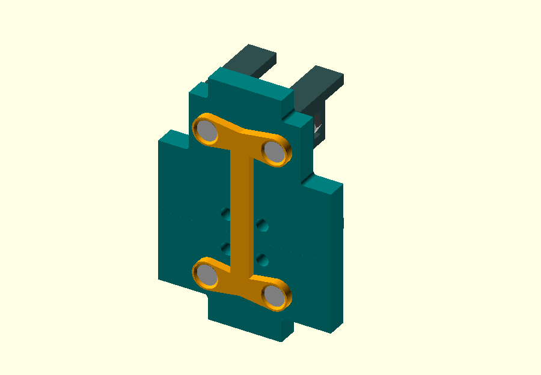
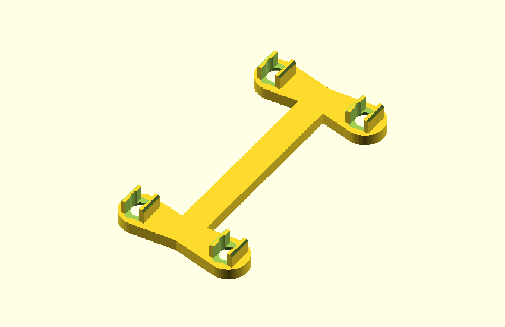

# Corner screw-beam joining brackets

Join adjacent modules using the M3 × 20 countersunk screws and captive nuts already in their outer corner beams. Fit a bracket at each shared junction on both faces.

Print flat with the guide cheeks facing up. Remove the individual adapters and screws from the corners being joined. Leave each nut in its beam. Press the bracket guides into those receivers and reinstall the same screws. For a two-hole upright, point the narrow spine toward the outside edge. Rotate the bracket in its own plane to fit the opposite side. Use the across strip for a left-to-right seam and a four-hole bracket where four frames meet. On a 2x7 below a vertical joint, centre its first two fixed location labels 9.65 and 20.85 mm below the top corner beam axis.

| Part | Applications | Editable CAD |
| --- | --- | --- |
| [edge_across](edge_across.stl) | 1x1 flush, 2x2 flush, 2x7 flush, 2x7 with 2 mm tier gap | [SCAD](edge_across.scad) |
| [edge_upright_41p5](edge_upright_41p5.stl) | 1x1 flush, 2x2 flush | [SCAD](edge_upright_41p5.scad) |
| [tee4_41p5](tee4_41p5.stl) | 1x1 flush, 2x2 flush | [SCAD](tee4_41p5.scad) |
| [edge_upright_32p5](edge_upright_32p5.stl) | 2x7 flush | [SCAD](edge_upright_32p5.scad) |
| [tee4_32p5](tee4_32p5.stl) | 2x7 flush | [SCAD](tee4_32p5.scad) |
| [edge_upright_34p5](edge_upright_34p5.stl) | 2x7 with 2 mm tier gap | [SCAD](edge_upright_34p5.scad) |
| [tee4_34p5](tee4_34p5.stl) | 2x7 with 2 mm tier gap | [SCAD](tee4_34p5.scad) |

[Installed CAD detail](installed.scad)

[CAD fit checks](validation.json)
