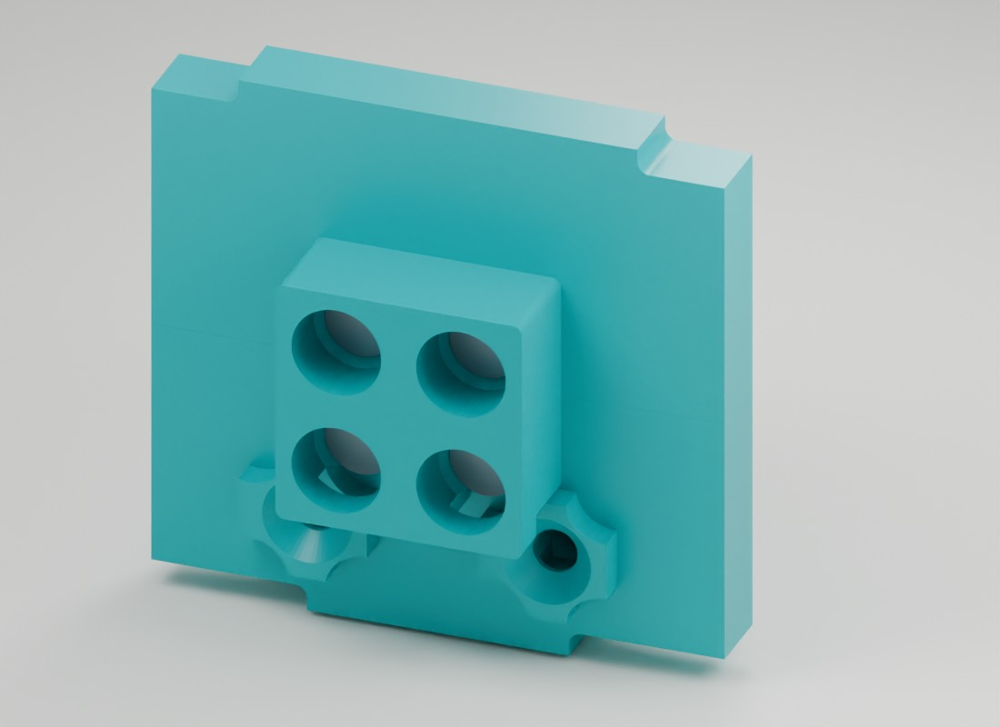
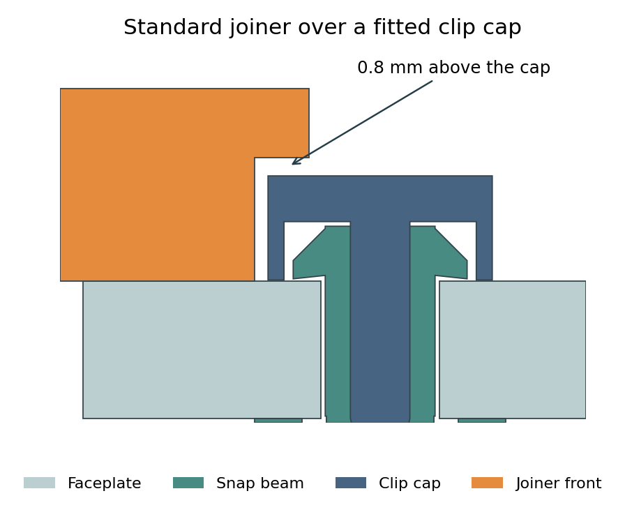
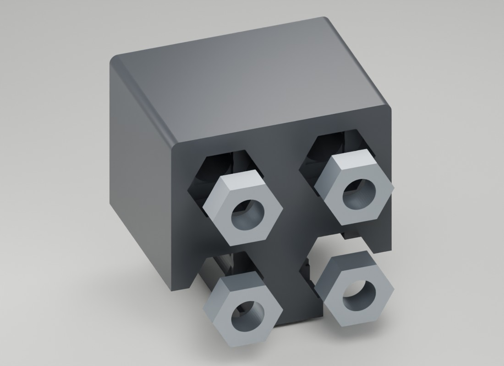
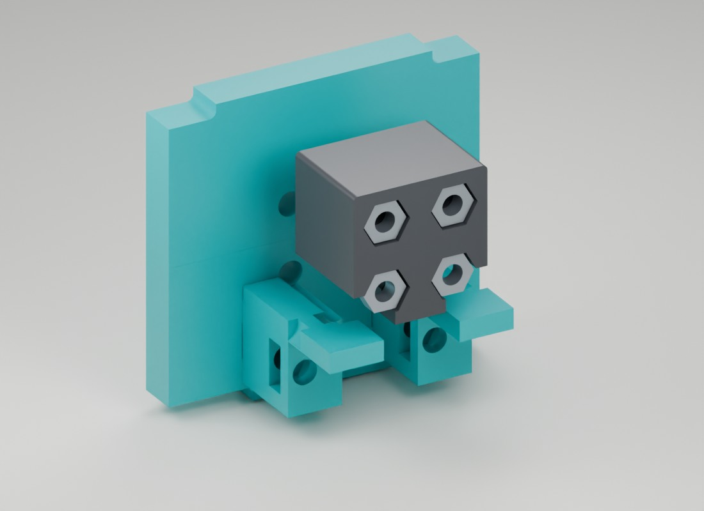
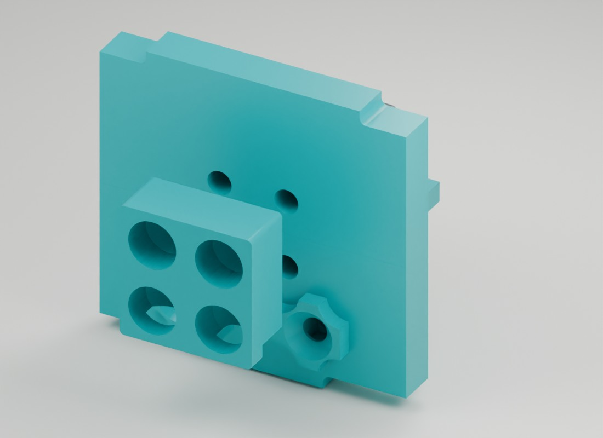
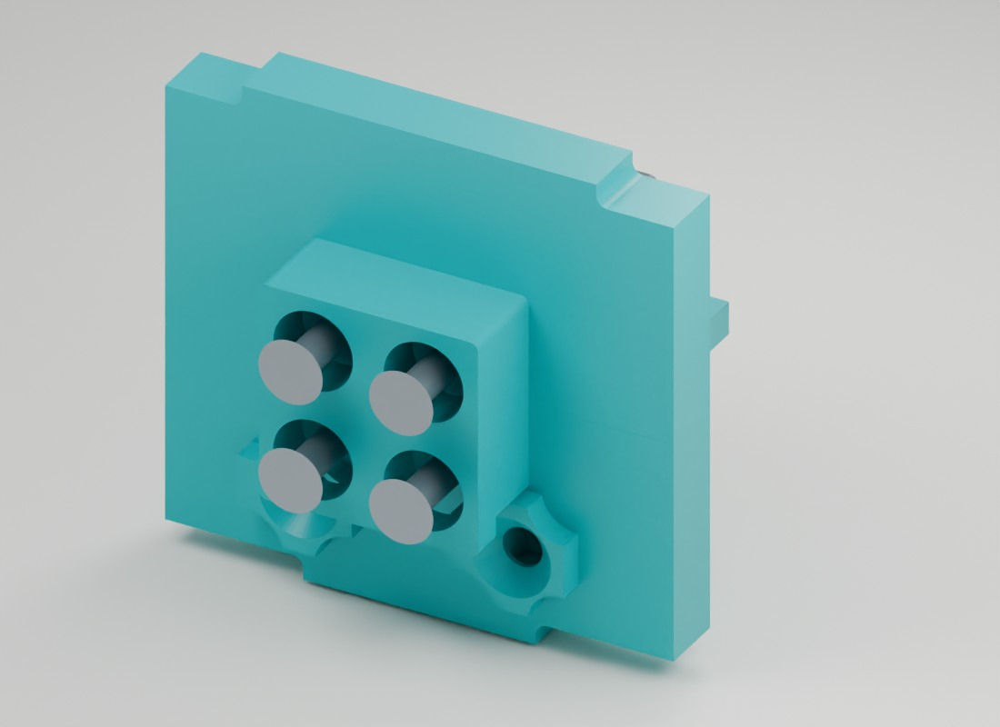

# V8 joining brackets

Join two V8 frames along an edge, or join four at a corner. The standard and loose-clearance fronts share the same matching extruded backer for each shape.

This project was largely AI-generated. Editable CAD sources and print kits are included. AI-generated CAD images and instructions. Errors possible. Check fit on your printer before making a full set.

[Download the print kit](print_files.zip) · [Printing instructions](printing.txt) · [Assembly data](assembly.json)

[View the illustrated manual](assembly.pdf) · [Download PDF](https://raw.githubusercontent.com/oomlout/organization_storage_drawer_unit/main/parts/oobb_organization_storage_drawer_unit_systempak_209_100_ml_joiners_v8/assembly.pdf) · [Download offline HTML](assembly.html?raw=true)

## Details

Fits [1 × 1 drawer unit](../oobb_organization_storage_drawer_unit_systempak_209_100_ml_1_column_1_row_v8/README.md) and [2 × 2 drawer unit](../oobb_organization_storage_drawer_unit_systempak_209_100_ml_2_column_2_row_v8/README.md).

Choose one outside front style. The standard pockets give 0.8 mm above the fitted cap and 0.6 mm at the sides. The looser option gives 1.1 mm above and 0.9 mm at the sides.

[Standard fronts](joiners.stl) · [Looser fronts](joiners_clasp_clearance.stl) · [Backers](joiner_backers.stl) · [Seven-piece fit trial](joiner_fit_samples.stl)

## Parts

Quantities for one four-way junction. For a two-frame edge use the two-hole front, its matching backer and two screws and nuts.

| Part | Quantity |
| --- | ---: |
| [Four-hole front](joiners.stl) | 1 |
| [Matching backer](joiner_backers.stl) | 1 |
| [M3 × 25 countersunk screw](https://github.com/oomlout/oomp_hardware_screw_version_5/tree/main/parts/hardware_screw_countersunk_hex_head_black_m3_diameter_25_mm_length) | 4 |
| [M3 hex nut](https://github.com/oomlout/oomlout_oomp_version_1_messy/tree/main/parts/hardware_nut_m3) | 4 |

## Assembly

Print in the supplied orientations. Clear loose filament from the screw bores and nut pockets before fitting hardware.

### 1. Load the backer

Press an M3 nut into each rear pocket. The four-way plate uses four nuts. Use two for an edge strip.

### 2. Align the faceplates

Bring the frame edges together while the inside is accessible. Hold the nuts in place and offer the backer 8 mm above its seat, then slide it down into the rail relief.

### 3. Fit the front

Seat the clip caps or screw adapters first. Match the pockets in the joiner front to those fittings and press its lands against the faceplates.

### 4. Tighten the joint

Start each M3 × 25 countersunk screw from outside. Tighten evenly by hand and check that the drawers and clasps move freely.

The [validation report](validation.json) records nominal CAD fit. Print tolerances, strength and long-term loading still need a physical trial.
