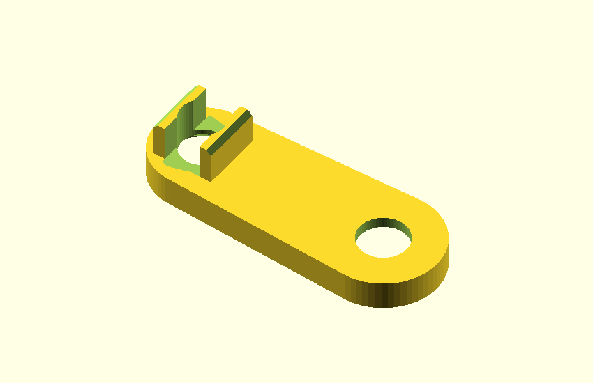

# Corner screw-beam to plywood joint

Connect an outside corner beam to the front or rear edge of a 12 mm plywood side. The 3.5 × 16 mm countersunk wood screw is centred 6 mm from either plywood face.

Print flat with the guide cheeks facing up. Remove the corner screw and its individual adapter. Seat the joint's two guide cheeks in the same receiver. Refit the same screw into the nut inside the beam. Mark the plywood through the other hole, drill a Ø2.5 mm pilot 16 mm deep in the centre of the edge, then fit the wood screw. Test the pilot in an offcut.

| Part | Applications | Editable CAD |
| --- | --- | --- |
| [plywood_joint](plywood_joint.stl) | 1x1 flush, 2x2 flush, 2x7 flush | [SCAD](plywood_joint.scad) |

[Installed CAD detail](installed.scad)

[CAD fit checks](validation.json)
