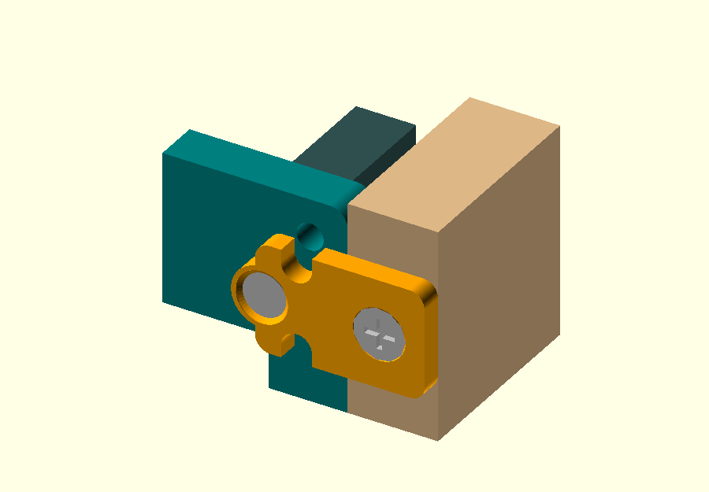
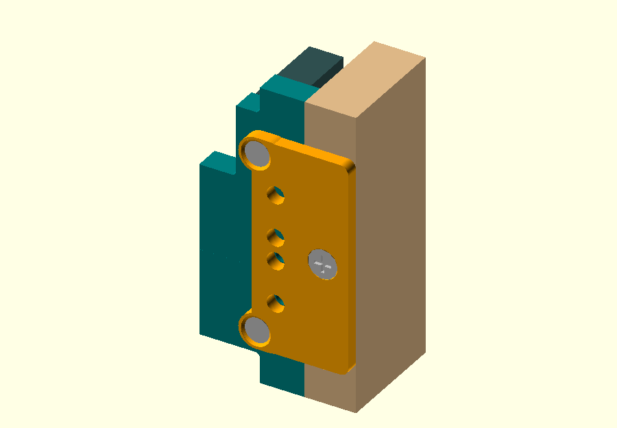

# Corner screw-beam to plywood joint

Use the single-contact plate at an outside corner. Use the two-contact plate where two stacked frames meet the same plywood side. Both 3 mm plates finish flush with the outside edge of the plywood. The 3.5 × 16 mm countersunk wood screw is centred 6 mm from either plywood face.

The plate sits 3 mm proud of the frame. The locating cheeks extend 2.95 mm into the original receivers.

Print flat with the guide cheeks facing up. Remove the screw and adapter at each participating corner. Seat one pair of guide cheeks in each exposed beam receiver. Refit each M3 screw into its captive beam nut. Mark the plywood through the other hole, drill a Ø2.5 mm pilot 16 mm deep in the centre of the edge, then fit the wood screw. Test the pilot in an offcut.

| Part | Applications | Editable CAD |
| --- | --- | --- |
| [plywood_joint](plywood_joint.stl) | 1x1 flush, 2x2 flush, 2x7 flush, 2x7 with 2 mm tier gap | [SCAD](plywood_joint.scad) |
| [plywood_double_41p5](plywood_double_41p5.stl) | 1x1 flush, 2x2 flush | [SCAD](plywood_double_41p5.scad) |
| [plywood_double_32p5](plywood_double_32p5.stl) | 2x7 flush | [SCAD](plywood_double_32p5.scad) |
| [plywood_double_34p5](plywood_double_34p5.stl) | 2x7 with 2 mm tier gap | [SCAD](plywood_double_34p5.scad) |

[Installed CAD detail](installed.scad)

[CAD fit checks](validation.json)

On a 2×7 immediately below a two-contact plate, centre the first two fixed labels 9.65 mm and 20.85 mm below its upper beam axis. Keep each label centred on the faceplate margin.

[Two-contact installed CAD](double_installed.scad)
